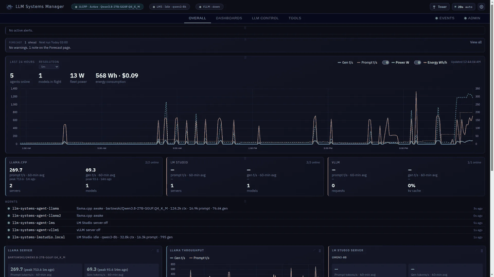

# LLM Systems Manager

One self-hosted dashboard to monitor, control, benchmark and tune every machine that runs your local LLMs.

**Works with** llama.cpp, vLLM, LM Studio and stable-diffusion.cpp · **GPUs:** NVIDIA, AMD (ROCm and Vulkan) and Apple Silicon · **Hosts:** Linux and macOS

Try the demo: https://demo.llmsyscore.com



## Install

Run this on the Linux machine that will host the dashboard. One interactive command sets up everything: prerequisites, InfluxDB, config, TLS and the first agent.

```bash
bash <(curl -fsSL https://get.llmsyscore.com/install.sh)
```

Prefer containers? Bring up the dashboard with Docker Compose instead (fill in `.env` before the last command):

```bash
curl -fsSLO https://raw.githubusercontent.com/llmsyscore/llm-systems-manager/main/docker-compose.yml
curl -fsSL https://raw.githubusercontent.com/llmsyscore/llm-systems-manager/main/.env.example -o .env
docker compose up -d
```

[What the install script does](docs/INSTALL_SCRIPT.md) · [All install options](docs/DEPLOYMENT.md) · The dashboard runs on Linux, or on macOS through Homebrew. Windows is not supported.

<details>
<summary><b>Native packages (.deb / .rpm)</b></summary>

Debian / Ubuntu:

```bash
url=$(curl -fsSL https://api.github.com/repos/llmsyscore/llm-systems-manager/releases/latest \
        | grep -oE '"https://[^"]+_all\.deb"' | tr -d '"')
curl -fsSLO "$url" && sudo apt install ./"${url##*/}"
```

RHEL / Fedora:

```bash
url=$(curl -fsSL https://api.github.com/repos/llmsyscore/llm-systems-manager/releases/latest \
        | grep -oE '"https://[^"]+\.noarch\.rpm"' | tr -d '"')
curl -fsSLO "$url" && sudo dnf install ./"${url##*/}"
```
</details>

<details>
<summary><b>Homebrew</b> (macOS Apple Silicon and Linux)</summary>

```bash
brew tap llmsyscore/tap && brew trust llmsyscore/tap
brew install llm-systems-manager llm-systems-alarm-engine influxdb@2 influxdb-cli
llm-systems-influx-setup
brew services start llm-systems-manager
brew services start llm-systems-alarm-engine
llm-systems-admin-password reset
```
</details>

**Add more machines.** Run the same install command on each machine you want to watch and pick **mode 5 (agent)**, or copy the ready-made command from **Admin → Agents → Manage ▾ → Enrollment**. Then approve the machine in **Admin → Agents**. Homebrew and a standalone agent binary are also available: see [Installing agents](docs/DEPLOYMENT.md#installing-agents-on-remote-computers).

**First sign-in.** Open `http://<this-host>:5000/` and sign in with the admin login the installer showed you.

## Video tour

Six minutes through sign-in, every dashboard, Tower, LLM Control, the Tools, chat, image generation, alerts and the Admin pages.

https://github.com/user-attachments/assets/b2da9caf-9437-4001-acdc-cd12567fa786

**[▶ Screenshot viewer](https://www.llmsyscore.com/#screenshots)**: all 30 screens, full size.

## What it does

- **Tower assistant.** Ask about your machines, models, alerts and energy in plain language. It proposes actions (load a model, restart a server) for you to approve.
- **Forecast.** Spots trouble early: disks filling, memory running short, temperatures rising, throughput dropping.
- **Benchmark and Autotune.** Measures your running server and tunes context, KV cache, threads, speculative decoding and more for speed or fit.
- **GPU Report Card.** One standard benchmark you can compare across machines and providers.
- **Model Autopilot.** Keeps the models you choose loaded on a machine with room for them, and moves them when a machine goes down.
- **Energy and cost.** What your inference costs per million tokens, and what you save against hosted APIs.
- **One API for every machine.** An OpenAI-compatible endpoint that routes each request to a machine serving that model.
- **Remote control.** Start servers, swap models, edit configs, update llama.cpp, read logs and open a terminal from the browser.
- **Live monitoring and alerts.** Slots, tokens per second, KV cache and context beside GPU, power, UPS and cooling, with email, webhook and Discord alerts.
- **Also:** scheduled jobs, model downloads from Hugging Face, a phone app with push alerts, multiple users, an audit log, encrypted backups and TLS everywhere.

Full list: [Features](docs/FEATURES.md).

## Documentation

| Guide | What's in it |
|---|---|
| [Deployment](docs/DEPLOYMENT.md) | Every install method, multiple machines, offline installs, configuration, updating, troubleshooting, uninstalling |
| [Features](docs/FEATURES.md) | Everything that ships, with screenshots |
| [Architecture](docs/ARCHITECTURE.md) | How the manager, alarm engine and agents fit together, storage and security |
| [API reference](docs/API_REFERENCE.md) | Every HTTP endpoint, including the OpenAI-compatible gateway |

**Updating.** `sudo bash /opt/llm-systems-manager/tools/installer/install.sh --update`, or `brew upgrade` / your package manager. See [Updating](docs/DEPLOYMENT.md#updating).

**Anonymous reports.** The installer asks once whether to send an anonymous install report (version, where the code came from, operating system, hardware), crash reports and a daily check-in (version, operating system, install channel). Turn any of them off in **Settings › Telemetry & analytics**, or set `DO_NOT_TRACK=1`. What each report contains: [Anonymous reports](docs/DEPLOYMENT.md#anonymous-reports).

## Contributing and donations

Issues and pull requests are welcome. If you find this project useful, please consider a donation.

<!--START_SECTION:buy-me-a-coffee-->
<a href="https://www.buymeacoffee.com/llmsystems" target="_blank"></a>
<!--END_SECTION:buy-me-a-coffee-->

## License

[GNU Affero General Public License v3.0](LICENSE)
